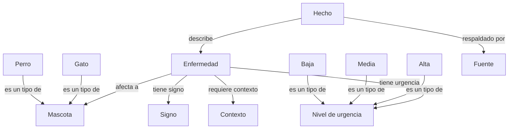
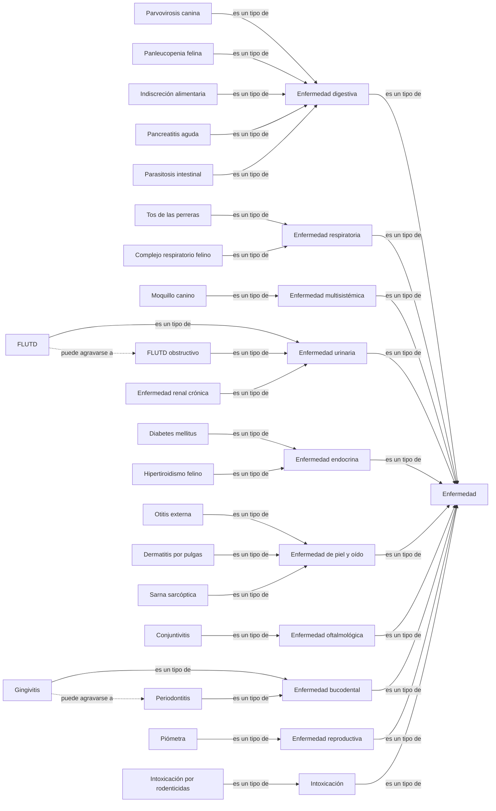
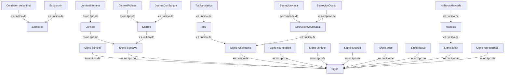

[ontologia_sistema_experto_mascotas.md](https://github.com/user-attachments/files/34288715/ontologia_sistema_experto_mascotas.md)
# Ontología del dominio

Esta ontología representa los **conceptos, características, instancias y vínculos** empleados en el sistema experto de diagnóstico preliminar de enfermedades comunes en perros y gatos. Los conceptos salen de la tabla de hechos (H1–H20) y de las reglas de producción (R1–R30) de la base de conocimiento, que a su vez se apoyan en Muñoz Rascón et al. (2015) y Esquivel y Reyes (2014).

## 5.1 Clases o conceptos y su jerarquía

### Clases principales

| Clase | Descripción | Subclases |
|---|---|---|
| Mascota | Animal al que se le hace la consulta | Perro, Gato |
| Enfermedad | Cuadro clínico que el sistema puede sugerir como posible | Digestiva, Respiratoria, Multisistémica, Urinaria, Endocrina, Piel y oído, Oftalmológica, Bucodental, Reproductiva, Intoxicación |
| Signo | Síntoma que el dueño puede observar sin equipo médico | General, Digestivo, Respiratorio, Neurológico, Urinario, Cutáneo, Ótico, Ocular, Bucal, Reproductivo |
| Contexto | Dato sobre el animal o su entorno que no es un síntoma | Condición del animal, Exposición |
| Nivel de urgencia | Gravedad asignada a cada enfermedad | Baja, Media, Alta |
| Hecho | Afirmación tomada de una fuente (H1–H20) | — |
| Fuente | Documento del que sale cada hecho | Muñoz et al. (2015), Esquivel y Reyes (2014) |

### Instancias de enfermedad

La causa y la urgencia de cada enfermedad se toman de los hechos H1–H20. Los signos y el contexto son los predicados usados en las reglas.

| Enfermedad | Especie | Signos y contexto | Clasificación |
|---|---|---|---|
| Parvovirosis canina | Perro | `Vomitos`, `DiarreaConSangre`, `Letargo`, `Anorexia`; contexto: `Cachorro` o `VacunacionIncompleta` | Digestiva, viral, urgencia alta |
| Panleucopenia felina | Gato | `Letargo`, `Anorexia`, `Vomitos`, `DiarreaProfusa`; contexto: `Cachorro` o `VacunacionIncompleta` | Digestiva, viral, urgencia alta |
| Indiscreción alimentaria | Perro y gato | `Vomitos` o `Diarrea`, sin `DiarreaConSangre` ni `Letargo`; contexto: `ComioBasuraOAlimentoInadecuado` | Digestiva, dietética, urgencia baja |
| Pancreatitis aguda | Perro y gato | `VomitosIntensos`, `PosturaRezo` o `DolorAbdominal`, `Anorexia`, `Letargo` | Digestiva, multifactorial, urgencia alta |
| Parasitosis intestinal | Perro | `AbdomenAbultado`, `Diarrea` (cachorros); `DiarreaConSangre`, `PalidezMucosas`, `Debilidad`, `PerdidaPeso` | Digestiva, parasitaria, urgencia media |
| Moquillo canino | Perro | `SecrecionOculonasal`, `Tos`, `Vomitos` o `Diarrea`; `Mioclonias`, `Convulsiones`, `Ataxia`; contexto: `VacunacionIncompleta` | Multisistémica, viral, urgencia alta |
| Tos de las perreras | Perro | `TosParoxistica`, sin `Anorexia`; contexto: `ContactoConPerrosEnfermos` | Respiratoria, multietiológica, urgencia media |
| Complejo respiratorio felino | Gato | `Estornudos`, `SecrecionNasal`, `SecrecionOcular` u `OjoRojo` | Respiratoria, viral, urgencia media |
| FLUTD (sin obstrucción) | Gato | `Polaquiuria`, `Estranguria` | Urinaria, multifactorial, urgencia media |
| FLUTD obstructivo | Gato | `Estranguria`, `NoLograOrinar`, `Letargo` o `Vomitos` | Urinaria, multifactorial, urgencia alta |
| Enfermedad renal crónica | Perro y gato | `PoliuriaPolidipsia`, `PerdidaPeso`, `Anorexia`, `Vomitos` o `PalidezMucosas` | Urinaria, multifactorial, urgencia media |
| Diabetes mellitus | Perro y gato | `PoliuriaPolidipsia`, `PerdidaPeso`, `Polifagia` | Endocrina, déficit de insulina, urgencia media |
| Hipertiroidismo felino | Gato | `PerdidaPeso`, `Polifagia`, `Hiperactividad` o `PeloSeco` | Endocrina, alteración tiroidea, urgencia media |
| Otitis externa | Perro y gato | `SacudeCabeza` o `RascaOreja`; `SecrecionOido`, `MalOlorOido` o `CerumenOscuro` | Piel y oído, multifactorial, urgencia media |
| Dermatitis alérgica por pulgas | Perro y gato | Perro: `PruritoIntenso`, `LesionesLomoCola`, `VenPulgasOHeces`. Gato: `PapulasCostrosas`, `AlopeciaPorRascado`, `VenPulgasOHeces` | Piel y oído, hipersensibilidad a la picadura de pulga, urgencia baja |
| Sarna sarcóptica | Perro | `PruritoIntenso`, `LesionesOrejaCodos`, `CostrasGrisAmarillentas` o `AlopeciaPorRascado` | Piel y oído, parasitaria, urgencia media |
| Conjuntivitis | Perro y gato | `OjoRojo` o `ParpadoHinchado`, `SecrecionOcular`, sin `PupilaAlterada` | Oftalmológica, infecciosa o no infecciosa, urgencia baja |
| Gingivitis | Perro y gato | `Halitosis`, `EnciaRoja`, `EnciaInflamada` o `EnciaSangra`, sin signos de periodontitis | Bucodental, placa bacteriana, urgencia baja |
| Periodontitis moderada o avanzada | Perro y gato | `HalitosisMarcada`, `DientesFlojos`, `PerdidaDientes`, `RaicesExpuestas` o `PusEnEncia` | Bucodental, placa bacteriana, urgencia media |
| Intoxicación por rodenticidas | Perro y gato | `Hemorragia` o `Hematomas`, `Letargo`, `Disnea` o `PalidezMucosas`; `Convulsiones`, `Temblores` o `Ataxia`; contexto: `AccesoARaticida` | Intoxicación, tóxica, urgencia alta |
| Piómetra | Perra | `Letargo`, `Anorexia`, `DescargaVaginalPurulenta`, `Vomitos` o `PoliuriaPolidipsia`; contexto: `HembraEntera`, `CeloUltimosDosMeses` | Reproductiva, bacteriana tras el celo, urgencia alta |

### Instancias de signo y de contexto

| Clase | Instancias |
|---|---|
| Signo general | `Letargo`, `Anorexia`, `PerdidaPeso`, `Polifagia`, `PoliuriaPolidipsia`, `Hiperactividad`, `Debilidad`, `PalidezMucosas`, `Hemorragia`, `Hematomas`, `Disnea` |
| Signo digestivo | `Vomitos`, `VomitosIntensos`, `Diarrea`, `DiarreaProfusa`, `DiarreaConSangre`, `DolorAbdominal`, `PosturaRezo`, `AbdomenAbultado` |
| Signo respiratorio | `Tos`, `TosParoxistica`, `Estornudos`, `SecrecionNasal`, `SecrecionOculonasal` |
| Signo neurológico | `Convulsiones`, `Temblores`, `Ataxia`, `Mioclonias` |
| Signo urinario | `Polaquiuria`, `Estranguria`, `NoLograOrinar` |
| Signo cutáneo | `PruritoIntenso`, `VenPulgasOHeces`, `LesionesLomoCola`, `LesionesOrejaCodos`, `PapulasCostrosas`, `CostrasGrisAmarillentas`, `AlopeciaPorRascado`, `PeloSeco` |
| Signo ótico | `SacudeCabeza`, `RascaOreja`, `SecrecionOido`, `MalOlorOido`, `CerumenOscuro` |
| Signo ocular | `OjoRojo`, `ParpadoHinchado`, `SecrecionOcular`, `PupilaAlterada` |
| Signo bucal | `Halitosis`, `HalitosisMarcada`, `EnciaRoja`, `EnciaInflamada`, `EnciaSangra`, `DientesFlojos`, `PerdidaDientes`, `RaicesExpuestas`, `PusEnEncia` |
| Signo reproductivo | `DescargaVaginalPurulenta` |
| Condición del animal | `Cachorro`, `HembraEntera`, `CeloUltimosDosMeses`, `VacunacionIncompleta` |
| Exposición | `ContactoConPerrosEnfermos`, `AccesoARaticida`, `ComioBasuraOAlimentoInadecuado` |

## 5.2 Atributos y relaciones

### Atributos

| Clase | Atributo | Valores |
|---|---|---|
| Enfermedad | nombre | Texto |
| Enfermedad | causa | Viral, parasitaria, dietética, tóxica, endocrina, multifactorial, entre otras |
| Hecho | código | H1 a H20 |
| Hecho | fuente | Autor, año, capítulo y página |
| Signo | nombre | Nombre del predicado |

### Relaciones

| Relación | De → A | Descripción | Reglas donde se aplica |
|---|---|---|---|
| es un tipo de | Subclase → Clase | Jerarquía de enfermedades, signos y contexto. Entre signos, un signo concreto implica a uno más general | R26–R30 |
| afecta a | Enfermedad → Mascota | Especie en la que se presenta | R1, R2, R5–R12, R15, R17–R19, R25 |
| tiene signo | Enfermedad → Signo | Signos que la caracterizan | R1–R25 |
| requiere contexto | Enfermedad → Contexto | Dato adicional sobre el animal o su entorno | R1, R2, R3, R5, R7–R9, R23–R25 |
| tiene urgencia | Enfermedad → Nivel de urgencia | Gravedad asignada | Tabla de enfermedades |
| se compone de | Signo → Signo | `SecrecionOculonasal` es `SecrecionNasal` junto con `SecrecionOcular` | R29 |
| puede agravarse a | Enfermedad → Enfermedad | La gingivitis puede avanzar a periodontitis y el FLUTD a su forma obstructiva | R11 y R12, R21 y R22 |
| se puede confundir con | Enfermedad ↔ Enfermedad | Diagnóstico diferencial descrito en las fuentes | R1 y R7, R1 y R5–R6, R13–R14–R15–R25, R7 y R9 |
| respaldado por | Hecho → Fuente | Fuente de cada hecho | H1–H20 |
| describe | Hecho → Enfermedad | Enfermedad a la que se refiere el hecho | H1–H20 |

Pares que se pueden confundir, con su respaldo en el libro:

- **Parvovirosis y moquillo:** ambos figuran como diagnóstico diferencial (Muñoz et al., p. 63).
- **Parvovirosis y parasitosis intestinal:** se diferencian por la ausencia de vómitos en la parasitosis (p. 63).
- **Enfermedad renal crónica, diabetes mellitus, hipertiroidismo y piómetra:** las cuatro aparecen entre las causas de poliuria-polidipsia (cap. 13, p. 133).
- **Moquillo y tos de las perreras:** el virus del moquillo figura entre las causas de la tos de las perreras (p. 67).

## 5.3 Diagrama de la ontología

Las flechas con el texto son relaciones entre los conceptos.

### Clases principales y sus relaciones

### Jerarquía de enfermedades

### Jerarquía de signos y contexto

